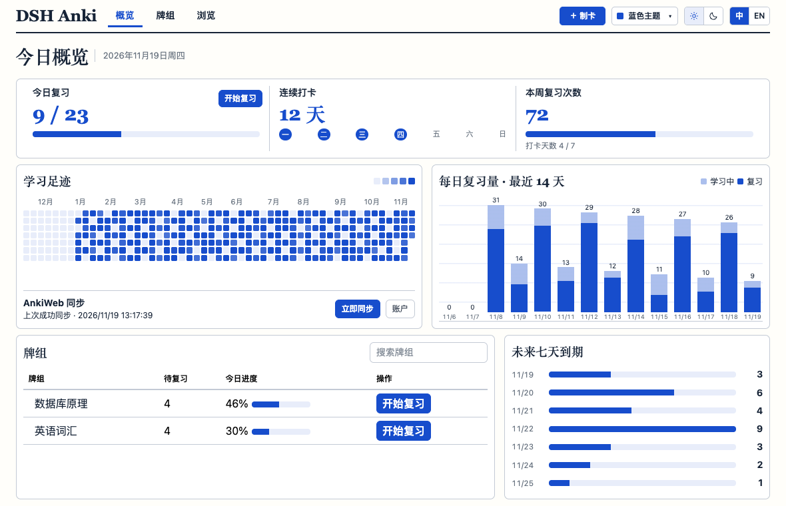

<div align="center">
  
  <h1>DSH Anki</h1>
  <p>在 DeepSeek Harness 里制卡、复习，也能让 AI 帮你整理同一份牌库。</p>
  <p>
    <a href="https://github.com/NanoShiki/dsh-anki/releases/latest"></a>
    <a href="https://www.npmjs.com/package/@nanoshiki/dsh-anki"></a>
    <a href="https://github.com/NanoShiki/dsh-anki/actions/workflows/test.yml"></a>
    <a href="./LICENSE"></a>
  </p>
  <p><a href="#快速开始">快速开始</a> · <a href="#在对话中使用">在对话中使用</a> · <a href="https://github.com/NanoShiki/dsh-anki/releases">版本记录</a> · <a href="#english">English</a></p>
</div>



DSH Anki 是独立开发的 DSH 插件。每个 DSH 配置都有自己的牌库，侧栏工作区和对话中的 `anki` 工具读写同一份数据。安装包内置 Anki 26.05 核心与 CPython 3.13.5，安装后即可离线制卡和复习。

## 快速开始

1. **安装插件。** 在 DSH 插件管理器中添加包名 `@nanoshiki/dsh-anki`，或下载预构建的 [dsh-anki.tgz](https://github.com/NanoShiki/dsh-anki/releases/latest/download/dsh-anki.tgz) 并在管理器中导入。GitHub 和 npm 的可用版本见页首徽章。
2. **启用 Anki。** 首次安装时将 `dataDir`、`pythonPath`、`ankiPackages` 留空，即可使用当前配置的私有牌库和内置运行时。按管理器提示刷新或重启，从 DSH 侧栏打开 **Anki**。
3. **试着做一张卡。** 在「牌组」中新建一个牌组，点右上角「＋ 制卡」，选好牌组和笔记类型，填入正反面并保存。回到概览，点击该牌组旁的「开始复习」。

| 环境 | 支持范围 |
| --- | --- |
| 桌面系统 | Windows x64，macOS 12 及以上（Apple Silicon / Intel） |
| DSH | `^0.2.1-rc.2`，已在 `0.2.1-rc.3` 验证 |
| AnkiWeb | 可选，跨设备同步时需要联网并登录自己的账号 |

## 工作区一览

| 入口 | 可以做什么 |
| --- | --- |
| **概览** | 查看今日进度、连续打卡、全年学习热力图和近 14 天复习量。未来七天到期预测将逾期卡计入今天。 |
| **牌组与复习** | 新建、重命名牌组，按牌组及其子牌组复习。翻面后选择重来、困难、良好或简单，由 Anki 排程下次复习。支持撤销最近一次可撤销的评分。 |
| **制卡与浏览** | 使用原生笔记类型和 Anki 搜索语法，编辑字段、标签，暂停或恢复卡片。富文本编辑器支持列表、上下标、HTML 源码和粘贴图片（单张最多 5 MiB）。 |
| **同步** | 从概览的学习热力图下方打开 AnkiWeb 同步面板，登录账号、查看进度、立即同步或调整自动同步。 |
| **外观** | 顶栏可选择预设主题色、切换浅色或深色模式以及中英文界面。 |

## 在对话中使用

打开 DSH 对话后，可以直接描述想对牌库做的事。例如：

> 在「英语」牌组中查找带有 travel 标签的笔记，列出它们的正面。
>
> 把“什么是间隔重复？”和“按记忆情况逐渐拉长复习间隔”做成一张问答卡，保存到「学习方法」牌组。

查询牌组、笔记和同步状态可在只读模式下进行。写入、导出、取下一张复习卡（`review.next`）、启动或取消同步需要 `danger-full-access`，因为牌库位于对话工作区之外。删除牌组、管理账号、修改同步设置和确认全量同步方向由已认证的所有者在界面中操作。

## 同步与数据

「立即同步」先同步牌库，再同步媒体，两者都成功才会更新上次成功时间。自动同步默认开启，写入后至少等待 15 秒空闲，常规检查周期约 5 分钟。**当前开发版**进一步限定为仅在概览可见、窗口有焦点且没有未保存的笔记编辑时触发。

**首次同步请留意覆盖方向。** 全量上传会替换云端牌库，全量下载会替换本地牌库，两种操作都需要本人确认。插件会先备份本地牌库和媒体；这份备份只能恢复本地数据。取消同步后，已完成的变更仍可能保留。

<details>
<summary><b>数据位置、账号与完整备份</b></summary>

默认数据目录是 `<profileContext.dir>/data/anki-workspace`。自定义 `dataDir` 时应使用独立目录，避免指向 Anki 桌面版配置。做完整备份时，先禁用插件，等后台 Python 进程退出，再复制整个数据目录，包括牌库、媒体与附属文件。

在同步面板输入账号密码。令牌由 Windows 当前用户 DPAPI 或 macOS 登录钥匙串保护，并绑定工作区路径。移动数据后可能需要重新登录。整目录备份包含受保护的账号状态，请私下保存。

</details>

<details>
<summary><b>APKG 交换、删除牌组与模板兼容性</b></summary>

- **导入导出**通过对话中的 `anki` 工具完成。用 `status` 查询目录，将待导入的 `.apkg` 放入 `importsDir`，再提供文件名。导入会合并内容并预先备份牌库；媒体写入无法原子回滚。导出会在 `exportsDir` 新建文件并保留已有文件。
- **删除牌组**会先预览受影响的子牌组、卡片和孤立笔记，并要求输入完整牌组名。删除普通牌组会删除其中的卡片，删除筛选牌组会将卡片送回原牌组。复习撤销无法恢复已删除的牌组，删除也可能同步到 AnkiWeb。
- **复杂模板**可在 HTML 源码模式编辑。复习器隔离卡片 HTML，禁用脚本和生成式 LaTeX，不支持桌面 add-ons、自定义复习 JavaScript 或 MathJax。

</details>

<details>
<summary><b>升级或从旧包名迁移</b></summary>

1. 等同步结束，禁用旧插件并等待后台进程退出。记下原来的 `dataDir` 并备份整个数据目录。
2. 已使用 `@nanoshiki/dsh-anki` 的用户可直接更新同一个包。若旧包名为 `@local/dsh-anki` 或 `@local/dsh-anki-workspace`，请保持旧包禁用或卸载旧包，保留数据目录，再安装新包。避免同时启用两份插件。
3. 在同一个 DSH 配置里沿用原来的 `dataDir`。清空旧的 `ankiPackages` 和 `pythonPath` 覆盖项即可使用内置核心。重新启用后，到「浏览」确认笔记和牌组。

</details>

## 开发与贡献

欢迎通过 [Issues](https://github.com/NanoShiki/dsh-anki/issues) 报告问题。反馈界面或同步问题时，请附上系统、DSH 与插件版本以及复现步骤，并隐去账号和私人卡片内容。

代码变更通过 Pull Request 合并到 `main`。本地可先用 Node.js 22+ 运行客户端和同步调度测试：

```sh
npm run test:client
```

完整开发流程和原生后端测试命令见[贡献指南](CONTRIBUTING.md)。自动化测试的覆盖范围见[验证记录](VERIFICATION.md)，使用真实 DSH 验收的步骤见[验收清单](ACCEPTANCE.md)。

## 许可与来源

DSH Anki 是独立集成，与 Anki 官方项目无隶属关系。插件采用 [AGPL-3.0-or-later](LICENSE)。随包组件各自的条款见 [Anki 许可](ANKI-LICENSE.txt)、[Python 许可](runtime/LICENSE.txt)和[第三方声明](THIRD-PARTY-NOTICES.md)。

[GitHub Releases](https://github.com/NanoShiki/dsh-anki/releases) 提供安装包校验值、对应源码与构建资料。仓库也提供[核心依赖锁定清单](core-lock.json)和[逐文件校验值](core-sha256.json)。

## English

DSH Anki brings flashcard editing, scheduled reviews and an activity dashboard to DeepSeek Harness. The sidebar and the `anki` AI tool share a private collection for each DSH profile. A bundled headless Anki core lets you study offline and optionally sync your collection and media through AnkiWeb.

**Install** on Windows x64 or macOS 12+ (Intel and Apple Silicon) with DSH `^0.2.1-rc.2`. Add `@nanoshiki/dsh-anki` in the DSH plugin manager or import the [prebuilt release package](https://github.com/NanoShiki/dsh-anki/releases/latest/download/dsh-anki.tgz). Leave the runtime and data paths empty for a first installation. Open **Anki** in the sidebar and choose **EN** in the top bar.

**Upgrading** from either legacy `@local` package? Wait for sync, disable the old plugin, let its worker exit and back up the whole data directory. Keep the same directory when enabling the new package. Full uploads replace the cloud collection and full downloads replace the local collection. Both require confirmation in the UI.
